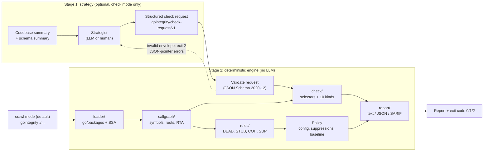
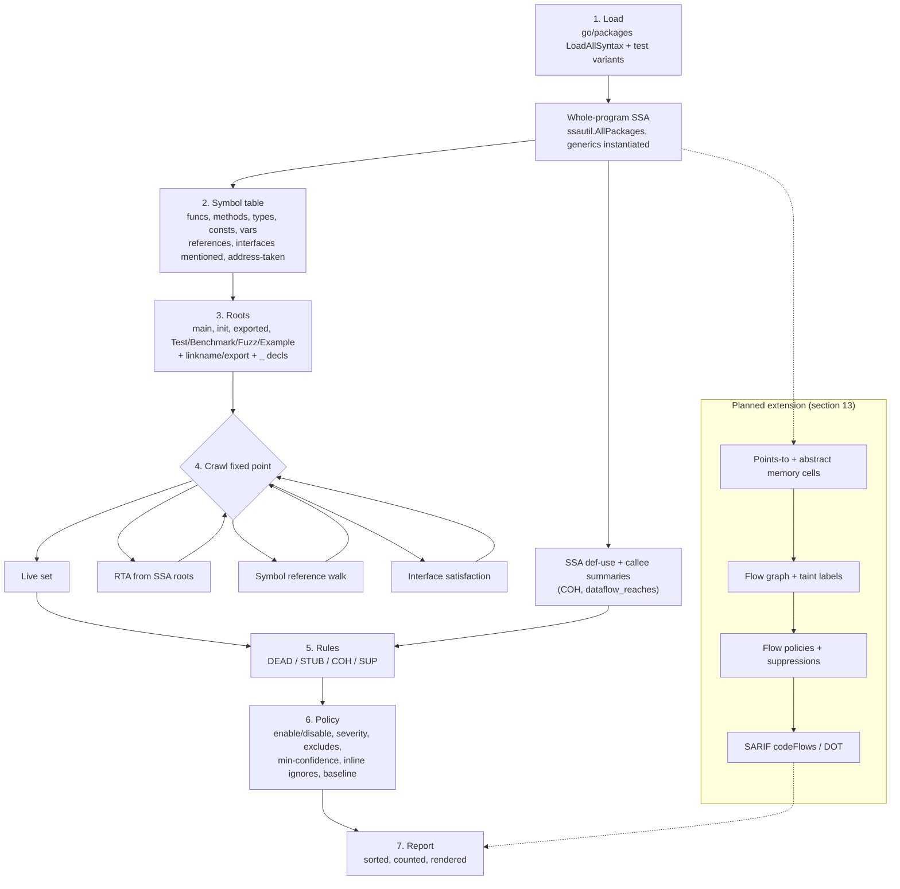

# gointegrity: Go Code Integrity Bot design document

| | |
|---|---|
| **Project** | Go Code Integrity Bot |
| **Tool** | `gointegrity`, a deterministic static analysis CLI for Go |
| **Status** | v1 built and validated (local commit `74718ab`, "gointegrity v1: crawl + check modes"). The whole-program data-flow tracking extension is approved and in progress. |
| **Tool version reported** | `0.1.0` |
| **Toolchain** | Go 1.22 or newer (developed with Go 1.27.3) |
| **Distribution** | Committed locally only. Not pushed or published. |

---

## Table of contents

1. [Purpose and goals](#1-purpose-and-goals)
2. [Non-goals](#2-non-goals)
3. [Architecture overview](#3-architecture-overview)
4. [How the crawl works](#4-how-the-crawl-works)
5. [Rules](#5-rules)
6. [Operating modes](#6-operating-modes)
7. [Check request schema v1](#7-check-request-schema-v1)
8. [Report format](#8-report-format)
9. [Configuration, baselines and inline suppressions](#9-configuration-baselines-and-inline-suppressions)
10. [CI integration](#10-ci-integration)
11. [v1 validation results](#11-v1-validation-results)
12. [Known v1 limitations](#12-known-v1-limitations)
13. [Planned extension: whole-program data-flow tracking (approved, in progress)](#13-planned-extension-whole-program-data-flow-tracking-approved-in-progress)
14. [Design principles and constraints](#14-design-principles-and-constraints)
15. [Open questions](#15-open-questions)

---

## 1. Purpose and goals

`gointegrity` finds integrity problems in Go codebases: code that is present
but does not do what it appears to do. It targets three families of defect:

- **Dead code.** Functions, methods, types, consts and vars that no entry
  point can reach.
- **Placeholders.** Stubs left in shipped code, such as empty bodies,
  `return nil`, hard-coded literals, `panic("not implemented")`, TODO-only
  bodies and not-implemented errors.
- **Incoherence.** Parameters that are accepted but never affect anything,
  and results that are constant regardless of input. In check mode this
  extends to explicit data-flow questions, such as "does this validated
  value actually reach the payment call?"

Goals:

- **Determinism.** The same code, configuration and request always produce
  byte-identical output.
- **No LLM in judgement.** Every verdict comes from static analysis.
- **CI first.** The tool is fast enough to run on every commit, has stable
  exit codes, emits SARIF for GitHub code scanning, and supports baselines so
  CI fails only on new findings.
- **Exact semantics.** Every rule and check kind has a documented,
  reproducible definition. When the engine cannot decide something exactly,
  it says `unresolved`. It does not guess.
- **Two modes.** *Crawl* is an exhaustive, rule-driven sweep and the default
  mode. *Check* runs a targeted set of checks written by a strategist (an LLM
  or a human) and judged only by the engine.

## 2. Non-goals

- **No architectural decisions about the user's application.** The tool
  reports facts about reachability, placeholders and data flow. It does not
  decide how the application should be structured, which packages should
  exist, or what the business logic should be.
- **No LLM ever judges results.** An LLM may act as a *strategist* that
  proposes checks in check mode (and, in the planned extension, flow
  policies). It never sees the analysis results as an authority, never marks
  a check passed or failed, and never filters findings.
- **Not a general linter or style checker.** Formatting, naming and idiom
  checks are out of scope.
- **No code modification.** The tool reads and reports. It never rewrites
  source.

## 3. Architecture overview

`gointegrity` is built on the standard Go analysis stack: `go/ast`,
`go/parser`, `go/types`, `golang.org/x/tools/go/packages`, and
`golang.org/x/tools/go/ssa` (with `ssautil` and `go/callgraph/rta`).

### 3.1 Packages

| Package | Responsibility |
|---|---|
| `loader/` | `go/packages` (LoadAllSyntax, tests) produces type-checked syntax plus whole-program SSA |
| `callgraph/` | Symbol table (funcs, methods, types, consts, vars), roots, RTA reachability plus symbol reference walk plus interface satisfaction, and deterministic shortest call paths (`index.go`, `roots.go`, `reach.go`) |
| `rules/` | Crawl rules: dead code (`dead.go`), placeholders on the AST (`stubs.go`), coherence on SSA with interprocedural parameter summaries (`coherence.go`), the data-flow engine (`dataflow.go`, `flow.go`), suppressions (`suppress.go`) and the rule registry (`registry.go`) |
| `check/` | Request parsing and JSON Schema validation (`request.go`), selector resolution (`selector.go`), the 10 check kinds (`kinds.go`) and execution (`run.go`) |
| `config/` | `.gointegrity.yml`, path globs, baselines, stable hashing |
| `report/` | The unified report model (`model.go`) and the text, JSON and SARIF 2.1.0 renderers (`render.go`) |
| `schemas/` | `check-request.v1.json` and `report.v1.json`, embedded via `schemas.go` |
| `cmd/gointegrity/` | The CLI (`main.go`, `crawl.go`) |

### 3.2 Two-stage architecture



The stage split is strict. The strategist only proposes. The engine runs
exactly the checks in the request: it never adds, drops or reinterprets one.
Validation errors can be fed back to the strategist, but the strategist never
gets the authority to mark a check passed.

### 3.3 CLI surface (v1)

```text
gointegrity [crawl] [flags] [packages]            crawl (default; packages default to ./...)
gointegrity check --request FILE|- [flags] [packages]
gointegrity rules                                 list crawl rules
gointegrity schema request|report                 print a published JSON Schema
gointegrity version
```

| Flag | Modes | Meaning |
|---|---|---|
| `-C dir` | both | directory to analyze from. Paths in reports are relative to it. |
| `--format text\|json\|sarif` | both | output format (default `text`) |
| `-o file` | both | write the report to a file |
| `--config file`, `--no-config` | both | config file (default `.gointegrity.yml`/`.yaml` in the `-C` directory) |
| `--tests=true\|false` | both | load `_test.go` files (default true) |
| `--request FILE\|-` | check | request file (JSON or YAML). `-` reads stdin. |
| `--roots list` | crawl | `main,init,exported,tests,benchmarks,fuzz,examples` or `all` (default `all`) |
| `--fail-on error\|warning\|note\|never` | crawl | threshold for exit code 1 (default `warning`) |
| `--min-confidence medium\|high` | crawl | drop lower-confidence findings (default `medium`) |
| `--enable/--disable sel` | crawl | rule ID, name, category, ID prefix or `all` |
| `--exclude glob` | crawl | drop findings in matching paths |
| `--baseline file` | crawl | hide findings whose fingerprints are in the baseline |
| `--write-baseline file` | crawl | write all current fingerprints and exit 0 |

## 4. How the crawl works

The crawl works like a web crawler. It starts from a set of entry points
(the "seed URLs"), follows every edge it can prove (calls, references,
interface dispatch), and marks everything it reaches as live. Whatever is
left unreached is a dead-code candidate.

### 4.1 Pipeline



### 4.2 Loading

`golang.org/x/tools/go/packages` loads the patterns with full syntax for the
whole dependency graph, including test variants. SSA is built for the whole
program. Each source file is analyzed once, even when it belongs to several
package variants (`p` and `p [p.test]`). Declarations are identified by
source position, so the variants collapse into one.

### 4.3 Symbol table

The symbol table holds every package-level func, method, type, const and var
of the analyzed packages. For each one it records:

- the target symbols it references (body, signature, type definition,
  initializer)
- the named interfaces it mentions
- whether a function is ever used as a value (address taken)

### 4.4 Entry points (roots)

| Root kind | What it seeds |
|---|---|
| `main` | `func main` plus the `init` of `package main` |
| `init` | all package initializers (func `init` and var initialization) |
| `exported` | exported package-level API of non-main packages. Exported methods count regardless of the receiver's visibility, because an unexported type can escape through an exported API. |
| `tests` / `benchmarks` / `fuzz` / `examples` | `Test*`/`TestMain`, `Benchmark*`, `Fuzz*`, `Example*` in `_test.go` files |
| always | `//go:linkname` local names, cgo `//export` names, and `_` declarations |

### 4.5 Call graph: the fixed point

The crawl repeats three steps until nothing new becomes live:

1. **RTA** (`go/callgraph/rta`) from the SSA roots. This finds reachable
   functions and resolves interface dispatch against the types that actually
   flow into interfaces. It also covers func values, method values, bound and
   thunk wrappers, and reflection-visible methods.
2. **Symbol reference walk.** Anything referenced from a live declaration
   becomes live, including types, consts, vars and functions referenced as
   values.
3. **Interface-satisfaction loop.** For a live type T, any method that
   implements a live or referenced interface (plus `error` and `Stringer`)
   becomes live. This covers compile-time assertions such as
   `var _ I = T{}`, plugin APIs, and interface methods called only from
   outside the program.

Call-path searches (used for evidence and for `reachable_from`/`calls`) are
breadth-first. Ties are broken by callee name and call-site position, so the
shortest path is deterministic.

### 4.6 Reflection approximation

RTA treats exported methods of runtime types (types that flow into
interfaces) as reachable. This approximates `reflect`-based dispatch. In
check mode, `reachable_from` passes reflection-only reachability with a
`reflection` note so the evidence is explicit. Code reached only via
`reflect.Value.Call`/`MethodByName` on types that never flow into an
interface, via templates, or by name from outside the program is not
modeled (see [section 12](#12-known-v1-limitations)).

## 5. Rules

`gointegrity rules` prints the rule table. Confidence is set per finding
(`high` or `medium`). Severity is set per rule and can be overridden in the
config.

| ID | Name | Default severity | What it flags |
|---|---|---|---|
| DEAD001 | unreachable-func | warning | function not reachable from any root |
| DEAD002 | unreachable-method | warning | method not reachable directly, via interface dispatch, via method values or via interface satisfaction |
| DEAD003 | unused-type | warning | type not referenced by reachable code. Its dead methods are folded into this finding. |
| DEAD004 | unused-const | warning | const not referenced by reachable code |
| DEAD005 | unused-var | warning | package var not referenced by reachable code |
| STUB001 | empty-body | warning | empty function body |
| STUB002 | zero-value-return | warning | body is only a `return` of zero values |
| STUB003 | empty-struct-return | warning | body only returns `T{}` / `&T{}` (plus zero values) |
| STUB004 | hardcoded-literal-return | warning | body only returns literals: placeholder strings, or any literals while every parameter is ignored |
| STUB005 | panic-not-implemented | error | `panic("not implemented")`, `panic("TODO...")`, `unimplemented`, `implement me`, ... anywhere in the body |
| STUB006 | todo-only-body | error | body is empty except for a TODO/FIXME/XXX comment |
| STUB007 | not-implemented-error | error | returns `errors.New`/`fmt.Errorf`/`status.Error(f)` with a not-implemented message, or an `ErrNotImplemented`-style sentinel |
| COH001 | param-unused | warning | parameter of an exported function is never referenced |
| COH002 | param-blank-assigned | warning | parameter is only ever assigned to `_` |
| COH003 | param-no-effect | warning | parameter is referenced, but its value never reaches a result, side effect, write, send, branch, or a callee that uses it (interprocedural) |
| COH004 | constant-result | warning | a non-error result is the same constant on every return path although the function has inputs |
| SUP001 | invalid-suppression | note | malformed `//gointegrity:ignore` (missing rule or reason, or an unknown rule) |

Categories: `dead-code`, `placeholder`, `coherence`, `suppression`.

### 5.1 Dead code (DEAD001–DEAD005)

```go
func deadFunc() int    { return 42 }         // DEAD001: only called from deadCaller,
func deadCaller() int  { return deadFunc() } // DEAD001: which is itself unreachable
func (c circle) diameter() float64 { ... }   // DEAD002 (high): never called
type unusedType struct{}                     // DEAD003 "(nor are its 1 method(s))"
const deadConst = 4                          // DEAD004 (high)
const ( modeA = iota; modeB )                // DEAD004 (medium) for modeB: partially used enum block
var deadVar = "x"                            // DEAD005
```

**Confidence.** `medium` for exported methods (code outside the program
might call them reflectively) and for consts in a partially used const
block. Everything else is `high`.

**Never reported.** Findings in generated files. Test-file symbols are
reported only when a test root kind is enabled.

**Near misses that must not fire** (covered by fixtures): exported methods of
types that flow into interfaces, `String()` reached via `fmt`, `sort.Sort`
methods, compile-time interface assertions, func and method values,
linkname targets, and marker methods.

### 5.2 Placeholders (STUB001–STUB007)

```go
func (s *Store) Flush() {}                                        // STUB001 medium
func (s *Store) Sync() { /* TODO: implement sync */ }             // STUB006 high
func (s *Store) Get(id string) (*Item, error) { return nil, nil } // STUB002 high (all params ignored)
func Count() (int, error) { return 0, nil }                       // STUB002 medium
func NewItem(id string) Item { return Item{} }                    // STUB003 high
func Describe(it Item) string { return "TODO" }                   // STUB004 high
func IsValid(it Item) bool { return true }                        // STUB004 medium (ignores it)
func (s *Store) Delete(id string) error { panic("not implemented") }    // STUB005 high
func Export(path string) error { return errors.New("not implemented") } // STUB007 high
func Backup(w io.Writer) error { ...; return ErrNotImplemented }        // STUB007 medium
```

**Coverage.** The rules cover empty bodies, `return nil` and zero-value
returns (`nil`, `0`, `""`, `false`, `nil, nil`, `0, nil`), empty struct
returns, hard-coded stub values, `panic("not implemented")`, TODO-only bodies,
and not-implemented errors.

**Confidence levels.** For STUB002–STUB004, confidence is `high` when the
function has named parameters and ignores all of them, or when the body has a
TODO comment. Otherwise it is `medium`.

**Exclusions** (each is covered by a fixture):

- **Generated files** (`// Code generated ... DO NOT EDIT.`). Test files are
  excluded unless `stubs.include-tests: true`.
- **Explicit no-op markers**, in a doc or body comment: `no-op`, `noop`,
  `nop`, `intentionally`, `deliberately`, `by design`, `does nothing`,
  `do nothing`, `nothing to do`, `not needed`, `gointegrity:noop`. Also
  receiver type names containing `noop`, `nop`, `null`, `discard`, `dummy`,
  `fake`, `mock`, `stub` or `unimplemented`.
- **Marker methods**: unexported, no params or results, empty.
- **Legitimate empties**: `T{}` of a field-less struct, and empty
  array/slice/map literals.
- **Zero-state constructors**: parameterless `New*`, `Default*`, `Empty*` or
  `Zero*`.
- **Whole-body heuristics** (STUB001–STUB004 only, all disabled by
  `stubs.strict: true`):
  - **Platform no-op files and variants.** A function with the same name is
    declared in a same-package file that the current build excludes (build
    tags, `_windows.go`, ...). Files named like `dummy.go`, `noop.go`,
    `fake_*.go` or `*_mock.go` are also excluded.
  - **Deprecated funcs.** The doc comment has a line starting with
    `Deprecated`.
  - **Strategy funcs.** The function is used as a func value, or its
    signature equals a named func type of its package (for example
    `cobra.PositionalArgs`).
  - **Capability methods and interface hooks.** A method matching an
    interface method signature that has an empty body (no results) or returns
    constant bool/number/string capability flags. `return nil` and
    `nil, nil` from an interface method are **still reported**.

### 5.3 Coherence (COH001–COH004)

```go
func Scale(v int, factor int) int { return v * 2 }             // COH001 factor (high)
func Format(msg string, level int) string { _ = level; ... }    // COH002 level (high)
func Put(key, value string) string { return key + sink(value) } // COH003 value (medium)
func sink(v string) string { n := len(v); _ = n; return "-" }
func Walk(depth int, label string) int { ...; return Walk(depth-1, label) + 1 } // COH003: only recursion
func Approve(it Item) bool { if it.ID == "" { ...; return true }; return true } // COH004 always true
```

**Interprocedural parameter usage.** SSA def-use is followed from the
parameter through conversions, field and index access, phis, arithmetic,
extracts, local allocations (composite literals) and closures. The parameter
counts as used when its value reaches any of:

- a `return` (inputs reach outputs)
- a store to non-local memory (a field write through a pointer, or a global)
- a channel send, a map update, or `panic`
- an `if` condition (control dependence)
- a call through an interface or func value, an external or bodiless
  function, or a goroutine
- a static callee whose own summary says that parameter is used

Callee summaries (`effect`, `flows-to-return`) are computed for every
function in the analyzed packages, iterated to a monotone fixed point over
the call graph. A parameter that is only passed to a recursive call of the
same function therefore does not count as used. If the value flows into a
callee's return, tracking continues with the call's result in the caller.

**COH004** considers only non-error results of functions with at least one
named parameter. The result's SSA operand must be the identical constant on
every return. Each return is listed as evidence.

**Exclusions.** Unnamed and `_` parameters; functions in test or generated
files; methods whose signature matches any interface method in the program;
functions used as values or matching a named func type; linkname and export
targets; `Deprecated` functions.

**Dedupe with stubs.** Functions already reported as whole-body placeholders
(STUB) are excluded from COH, so one defect produces one finding.

### 5.4 Suppression hygiene (SUP001)

A `//gointegrity:ignore` directive with no reason or an unknown rule is **not
applied**. It produces SUP001 (note) instead.

## 6. Operating modes

| Mode | Command | Who decides what to check | Who judges |
|---|---|---|---|
| **crawl** (default) | `gointegrity ./...` or `gointegrity crawl ./...` | the engine: every package, every function, all rules | the engine |
| **check** | `gointegrity check --request req.json ./...` | a strategist (LLM or human) writes a structured request | the engine, and only the engine |

### 6.1 Crawl mode (default, priority)

Crawl mode is the primary product. It needs no input beyond package
patterns, runs every enabled rule over every function, and is designed to
run in CI on every commit. Baselines and `--fail-on` make it practical to
adopt on an existing codebase.

### 6.2 Check mode (layered two-stage design)

1. **Stage 1, strategy.** An LLM or a human strategist writes a structured
   request, given the schema summary (kinds, params, selector fields) and a
   codebase summary. The prompt template is in
   `examples/strategist-prompt.md`. The strategist outputs exactly one
   request document that proposes checks, with no predictions and no extra
   fields.
2. **Stage 2, execution.** The deterministic engine validates the request,
   resolves selectors, runs only those checks, and returns per-target
   `pass`/`fail`/`error`/`unresolved` with locations and evidence.

**The stage split is strict.**

- The strategist never sees source analysis results as an authority and
  never judges outcomes.
- The engine never adds, drops or reinterprets a check.
- A check kind or selector the engine cannot execute exactly is reported as
  `error` or `unresolved`.
- The request's `metadata` is stored and hashed but never read by the
  analysis.

```sh
gointegrity check --request checks.json ./...
gointegrity check --request checks.yaml -C path/to/module --format sarif -o out.sarif
cat checks.json | gointegrity check --request - ./...
```

## 7. Check request schema v1

Schema: `schemas/check-request.v1.json` (JSON Schema 2020-12,
`$id: urn:gointegrity:schema:check-request:v1`), printed by
`gointegrity schema request`. Requests can be JSON or YAML. A YAML request
and its JSON equivalent hash identically and produce byte-identical reports.

### 7.1 Envelope

| Field | Rules |
|---|---|
| `schema` | must be `"gointegrity/check-request/v1"` |
| `request_id` | required, `^[A-Za-z0-9][A-Za-z0-9._:/-]{0,127}$`, echoed in the report |
| `metadata` | optional free-form provenance (`proposed_by`, `rationale`). Stored and hashed, **never interpreted**. |
| `checks` | 1–1000 checks, each with a unique `id`, a `kind`, optional `description`, `target`, `params`, `expect` |

No other top-level keys are allowed (`additionalProperties: false`).

### 7.2 Validation behavior

Every request is validated before any code is loaded.

- **Envelope errors** reject the whole request with exit 2 and a list of
  problems located by JSON pointer. Envelope errors are: bad JSON/YAML, wrong
  `schema`, missing `request_id`, unknown top-level keys, empty `checks`, and
  duplicate check ids.
- **Errors confined to one check** (unknown `kind`, unknown or missing
  params) mark only that check `error`. The other checks still run, and the
  exit code is 2.

### 7.3 The 10 check kinds

| Kind | Params | Passes when |
|---|---|---|
| `returns_error_on_invalid_input` | `error_result` (default: last result), `on_no_guard` (`fail`) | every validation-failure branch returns a provably non-nil error |
| `dataflow_reaches` | `from`, `from_result` (0), `to`, `to_arg` (any), `max_depth` (8); optional `target` scopes the callers | at each call site of `from`, result `from_result` reaches argument `to_arg` of a call to `to` |
| `param_used` | `param` (default: all named params) | every selected parameter is used in the COH sense |
| `no_placeholder` | `rules` (default STUB001–STUB007) | no placeholder rule matches |
| `reachable_from` | `root_kinds` and/or a `from` selector | an RTA call path exists. Reflection-only reachability passes with a `reflection` note. |
| `not_reachable` | same | no such path exists |
| `calls` | `callee` (selector or external symbol, e.g. `os.Exit`), `transitive` (true) | the target calls the callee (shortest path in evidence) |
| `never_calls` | same | it does not |
| `returns_nonzero` | `result` (0) | no SSA return path yields a constant zero value at that result |
| `pattern` | `op: contains_call` / `not_contains_call` + `callee`; `op: all_returns_nonnil` + `result` | the AST body does or does not contain the call, or every explicit `return` is non-`nil` at `result` |

**`returns_error_on_invalid_input`, summarized.** Input-derived values are
the parameters (not the receiver) plus locals assigned from them, computed
as a flow-insensitive fixed point. A *validation-failure branch* is an `if`
whose condition mentions an input-derived value, whose block ends in a
`return`, and whose condition is failure-shaped (such as `err != nil`,
`x == nil`, `!expr`, or an `invalid*`/`missing*`-style predicate) or whose
early return provably returns a non-nil error. The branch's error expression
is classified as follows: a `nil` literal is a fail; a call, a composite, a
sentinel or a guard-proven local is a pass; anything else is unresolved. If a
target has no validation-failure branch at all, its verdict is `on_no_guard`
(default `fail`).

**`dataflow_reaches`, summarized.** For each static call site of `from`, the
SSA value is traced forward within the function (conversions, `Extract`,
`Phi`, field and index access, arithmetic, slicing, type assertions, local
composites, closures). The trace also goes down into static callees and back
out through their results (context-sensitive), and up to static callers when
the value is returned, up to `max_depth`. The check fails with the list of
**dropping points**: discarded or `_`, never used afterwards, only compared,
only used in a branch, stored to non-local memory, passed to an external or
dynamic call, passed as the wrong argument, or returned from a function with
no static callers. Comparisons deliberately do not propagate.

### 7.4 Selectors

A selector picks functions and methods of the analyzed packages. All given
fields must match (logical AND). A bare string is shorthand for
`{"symbol": ...}`.

| Field | Meaning |
|---|---|
| `symbol` | exact `import/path.Func` or `import/path.Type.Method` (`import/path.(*Type).Method` also accepted) |
| `package` | glob on the import path, the module-relative path, or the last path element. A `/...` suffix selects the subtree. |
| `function` | glob on the function or method name |
| `receiver` | glob on the receiver base type (implies methods) |
| `kind` | `func`, `method`, `any` |
| `exported_only`, `include_tests` | booleans (test files are excluded by default) |
| `handlers.signature` | qualified named func type (e.g. `net/http.HandlerFunc`) |
| `handlers.implements` | qualified interface: selects that interface's methods on every implementing type |

### 7.5 Unresolved rather than guessing

- A selector that matches nothing, or names a type that does not exist,
  makes the check `unresolved`. The engine never falls back to a guess.
- `expect` is `{"outcome": "holds"|"violated", "quantifier": "all"|"any", "min_targets": N}`,
  with defaults `holds`, `all` and 1. With fewer than `min_targets` resolved
  targets the check is `unresolved`, so a selector typo cannot produce a
  vacuous pass. `violated` inverts each target's pass/fail.
- Target statuses: `pass`, `fail`, `unresolved` (cannot be decided exactly),
  `error`.
- Check status under `all`: `fail` if any target fails; else `unresolved`
  if any target is unresolved; else `pass`. A target `error`, an invalid
  check, an unknown kind or an internal error makes the check `error`.

### 7.6 Example request: the two headline checks

This request is the one used by the `shopgood`/`shopbad` fixtures
(`testdata/requests/payments.json`, with a YAML twin `payments.yaml`):

```json
{
  "schema": "gointegrity/check-request/v1",
  "request_id": "pay-001",
  "metadata": {"proposed_by": "strategist-llm", "rationale": "stored, never interpreted"},
  "checks": [
    {
      "id": "payments-handlers-reject-invalid",
      "kind": "returns_error_on_invalid_input",
      "description": "verify every handler in package payments returns an error on invalid input",
      "target": {"package": "payments", "handlers": {"implements": "example.com/shop/payments.Handler"}},
      "expect": {"quantifier": "all", "min_targets": 2}
    },
    {
      "id": "validated-order-reaches-payment",
      "kind": "dataflow_reaches",
      "description": "confirm ValidateOrder's output reaches ProcessPayment without being dropped",
      "params": {
        "from": "example.com/shop/orders.ValidateOrder", "from_result": 0,
        "to": "example.com/shop/payments.ProcessPayment", "to_arg": 0
      }
    }
  ]
}
```

Excerpt of the failing fixture's text report (`shopbad`):

```text
[FAIL] payments-handlers-reject-invalid (returns_error_on_invalid_input): 2 target(s): 0 pass, 2 fail, 0 unresolved, 0 error
  fail       example.com/shop/payments.ChargeHandler.Handle  payments/payments.go:30:24
             1 of 3 validation-failure branch(es) return a nil error
             - guard: if req.Amount <= 0 (payments/payments.go:34:5)
             - offending_return: returns nil as the error (nil literal) (payments/payments.go:36:39)
  fail       example.com/shop/payments.RefundHandler.Handle  payments/payments.go:48:22
             no validation-failure branch found (an if on an input-derived failure condition ending in return)

[FAIL] validated-order-reaches-payment (dataflow_reaches): 2 target(s): 0 pass, 2 fail, 0 unresolved, 0 error
  fail       example.com/shop/checkout.Checkout  checkout/checkout.go:11:32
             - dropped: value is never used afterwards (discarded or overwritten) (checkout/checkout.go:11:32)
  fail       example.com/shop/checkout.QuickCheckout  checkout/checkout.go:21:30
             - dropped: only compared (==); a comparison result is not data flow (checkout/checkout.go:22:10)
```

On `shopgood` the same request passes. The data-flow evidence shows the
value passing through `checkout.withDiscount` and back to `ProcessPayment`.

## 8. Report format

### 8.1 Unified report schema (both modes)

Schema: `schemas/report.v1.json`, printed by `gointegrity schema report`.
Every JSON golden is validated against it in the tests.

```json
{
  "schema": "gointegrity/report/v1",
  "mode": "crawl | check",
  "tool": {"name": "gointegrity", "version": "0.1.0"},
  "config_hash": "sha256:…",
  "request_id": "… (check)", "request_hash": "sha256:… (check)",
  "patterns": ["./..."], "roots": "main,init,… (crawl)", "fail_on": "warning",
  "summary": {"packages": 0, "files": 0, "functions": 0, "findings": 0,
              "by_severity": {...}, "suppressed": 0, "baselined": 0,
              "checks": 0, "by_status": {"pass":0,"fail":0,"error":0,"unresolved":0}},
  "rules":    [{"id","name","category","severity","description","enabled","count"}],
  "findings": [{"rule_id","rule","category","severity","confidence","message","symbol",
                "location":{"file","line","column"},"fingerprint","evidence":[...]}],
  "checks":   [{"id","kind","status","message",
                "targets":[{"symbol","status","message","location","evidence":[{"kind","message","location"}]}]}]
}
```

Crawl mode fills `rules` and `findings`. Check mode fills `checks`.

### 8.2 Output formats

- **text**: human-readable. Findings are grouped by rule, and checks show
  per-target evidence.
- **json**: the unified report above.
- **sarif**: SARIF 2.1.0 for GitHub code scanning.

### 8.3 Determinism guarantees

- Every list is sorted explicitly. Findings are sorted by rule, then file,
  line, column, symbol and message. Targets are sorted by symbol and
  location. Checks keep request order. Map iteration never reaches the
  output.
- Paths are relative to `-C` and slash-separated. There are no timestamps,
  durations, absolute paths or host names.
- Call-path searches are breadth-first with deterministic tie-breaking.
- `config_hash` and `request_hash` are SHA-256 hashes of canonical JSON
  (sorted keys).
- Fingerprints hash the rule, symbol, message and file, but **not line
  numbers**, so unrelated edits don't churn them.

### 8.4 Exit codes

| Code | Crawl | Check |
|---|---|---|
| 0 | no finding at or above `--fail-on` | every check `pass` |
| 1 | at least one finding at or above `--fail-on` | some check `fail` or `unresolved` |
| 2 | tool error (load/type errors, bad flags, bad config) | tool error, invalid request, or any check with status `error` |

### 8.5 SARIF mapping

- **Crawl:** one result per finding. `ruleId` is the rule ID and `level` is
  the severity. `partialFingerprints["gointegrity/v1"]` is the fingerprint.
  Evidence goes in `relatedLocations`, and `properties.confidence` and
  `properties.symbol` are set.
- **Check:** one result per target verdict. `ruleId` is the **check kind**,
  `properties.check_id` holds the check id and `properties.status` the
  target status. `kind`/`level` are mapped as follows:

  | Target status | SARIF `kind` / `level` |
  |---|---|
  | pass | `pass` / `none` |
  | fail | `fail` / `error` |
  | unresolved | `review` / `warning` |
  | error | `fail` / `error` |

  A check with no targets (error or unresolved) becomes a location-less
  result.

## 9. Configuration, baselines and inline suppressions

### 9.1 `.gointegrity.yml`

The file sits at the module root. Unknown keys are rejected, and
command-line flags override the config. See `examples/gointegrity.yml`.

```yaml
roots: [all]                         # main, init, exported, tests, benchmarks, fuzz, examples, all
tests: true
rules:                               # key: rule ID, name, category or ID prefix
  placeholder: {severity: error}     # broad selectors applied first, then more specific
  STUB001: {enabled: false}
  COH004: {severity: note}
exclude:
  - "internal/legacy/**"
  - "*_mock.go"
baseline: .gointegrity-baseline.json
fail-on: warning                     # error|warning|note|never
min-confidence: medium               # medium|high
stubs:
  include-tests: false
  strict: false                      # disable the legitimacy heuristics
coherence:
  include-tests: false
```

### 9.2 Baselines

```sh
gointegrity --write-baseline .gointegrity-baseline.json ./...
```

Commit the baseline file and reference it from the config. Findings whose
fingerprint is in the baseline are hidden and counted as `baselined`, so CI
fails only on new findings. Because fingerprints exclude line numbers,
baselines survive unrelated edits.

### 9.3 Inline suppressions

```go
//gointegrity:ignore DEAD001 kept for a debugging session
func suppressedDead() int { return 1 }

x := f(a) //gointegrity:ignore COH003,STUB002 reason text is required
```

- `<rule>` can be an ID, a name, a category, a prefix or `all`.
- A directive covers its own line and the next line. In a declaration's doc
  comment it covers the whole declaration.
- A reason is mandatory. A directive with no reason or an unknown rule is
  not applied and raises SUP001.
- The suppressed count appears in the report summary.

## 10. CI integration

Sample GitHub Actions workflow (from `examples/github-actions.yml`). It
uploads SARIF to code scanning, gates on new findings, and optionally runs a
committed check request.

```yaml
# .github/workflows/gointegrity.yml
name: gointegrity
on:
  pull_request:
  push:
    branches: [main]

permissions:
  contents: read
  security-events: write   # upload SARIF to code scanning

jobs:
  crawl:
    runs-on: ubuntu-latest
    steps:
      - uses: actions/checkout@v4
      - uses: actions/setup-go@v5
        with:
          go-version: stable
      - name: Install gointegrity
        # Replace with the module path you publish the tool under, or build from a vendored copy.
        run: go install ./tools/gointegrity/cmd/gointegrity
      - name: Crawl (SARIF for code scanning)
        run: gointegrity crawl --format sarif -o gointegrity.sarif ./... || true
      - uses: github/codeql-action/upload-sarif@v3
        with:
          sarif_file: gointegrity.sarif
          category: gointegrity
      - name: Gate on new findings (uses .gointegrity.yml baseline + fail-on)
        run: gointegrity crawl ./...

  checks:
    # Optional: run a committed check request (written by a strategist, human or LLM).
    runs-on: ubuntu-latest
    if: hashFiles('integrity/checks.json') != ''
    steps:
      - uses: actions/checkout@v4
      - uses: actions/setup-go@v5
        with:
          go-version: stable
      - run: go install ./tools/gointegrity/cmd/gointegrity
      - run: gointegrity check --request integrity/checks.json --format json -o checks-report.json ./...
      - uses: actions/upload-artifact@v4
        if: always()
        with:
          name: gointegrity-checks
          path: checks-report.json
```

The install step is a placeholder, because the tool is not yet published
(see [Open questions](#15-open-questions)).

## 11. v1 validation results

### 11.1 Test suite

- **44 tests pass** (`go test ./...`), including golden tests for exact
  text/JSON/SARIF output and exit codes in both modes.
- **Determinism is byte-identical.** `TestDeterminism` runs crawl and check
  twice each and diffs the output. `TestYAMLEqualsJSON` confirms that YAML
  and JSON requests produce identical reports.
- `TestReportSchema` validates every JSON golden against `report.v1.json`.
  `TestSARIFShape`, `TestBaselineRoundTrip` and `TestToolErrors` cover the
  remaining behavior. Unit tests cover globs, rule resolution, placeholder
  regexes, root parsing and request validation.
- Fixtures: `crawl` (every rule plus near misses), `config`, and
  `shopgood`/`shopbad` (the headline check examples). Requests: `payments`
  (JSON and YAML), `allkinds.yaml`, and `invalid/*`.
- The tool is clean on its own source: `gointegrity ./...` reports 0
  findings.

### 11.2 Real repositories

These ran with defaults (all roots, tests loaded). Each run was repeated,
and the two JSON outputs were byte-identical.

| Repo (commit) | Go LOC | Time | Findings |
|---|---|---|---|
| gorilla/mux (db9d1d0) | 7.5k | 1.9s | 0 |
| rakyll/hey (5626f79) | 1.3k | 1.9s | 0 |
| google/uuid (2d3c2a9) | 3.0k | 1.2s | 0 |
| spf13/cobra (adbc881) | 16.8k | 1.3s | 2 real findings |
| junegunn/fzf (99bfd5a) | 34.4k | 1.6s | 6 medium DEAD004 |

- **cobra: 2 real findings.** `doc.GenYamlCustom` never uses its
  `linkHandler` parameter (COH001). `doc.GenYamlTreeCustom` only passes
  `linkHandler` along to `GenYamlCustom` and to itself (COH003, found
  interprocedurally).
- **fzf: 6 medium DEAD004 unused constants.** These are unused members of a
  color enum block (`colBright*`) and an unused test const. They are
  technically correct, and medium confidence because the enum block is
  partially used.
- **Check mode on cobra** (sanity request): `calls` (`Command.ExecuteC`
  calls `Command.execute`), `dataflow_reaches` (`Command.Find` result reaches
  `Command.execute`), `returns_error_on_invalid_input` over `*Args`
  validators (three pass; the rest are correctly `unresolved` because they
  return `PositionalArgs`), `no_placeholder` over 129 exported `Command`
  methods, and `never_calls os.Exit`.

### 11.3 False positives fixed along the way

| False positive | Fix |
|---|---|
| mux `Match(r, match)` implementations of `matcher` flagged COH001 | interface signatures compared without parameter names |
| fzf build-tagged no-ops (`dummy.go` renderer, `protector.Protect`, `util.IsWindows`) flagged STUB001/002 | platform-variant and no-op-file heuristics |
| fzf `NeedScrollbarRedraw() bool { return false }` | interface-hook / capability-method heuristic |
| cobra `ArbitraryArgs` / `NoFileCompletions`, and `// Deprecated` zsh no-ops (STUB002, then COH001) | strategy-func and Deprecated heuristics |

Remaining expected noise: unexported interface-hook methods returning `nil`
errors, and enum constants kept for completeness. The controls for these
are `--min-confidence high`, rule overrides and suppressions.

## 12. Known v1 limitations

| Area | Limitation |
|---|---|
| **Reflection, templates, plugins** | Code reached only via `reflect.Value.Call`/`MethodByName` on types that never flow into an interface, via `text/template` field access, or by name from outside the program (RPC registries, plugins) can be falsely reported as dead. Exported methods of interface-flowing types are always live. |
| **Libraries** | With `exported` roots everything exported is live, so library dead-code findings cover only unexported code. For applications use `--roots main,init,tests`. |
| **Build configuration** | Only the current GOOS/GOARCH/tags are analyzed. Code used only under other tags may look dead (platform variants are recognized for placeholder rules only). |
| **Struct fields** | No dead-code reporting for fields or struct members. |
| **linkname / export** | Only local `//go:linkname` and cgo `//export` directives become roots. Symbols pulled in by other packages' linkname directives are not modeled. |
| **Heap and global values** | Values stored to the heap or to globals are not tracked further. For COH they count as a use; for `dataflow_reaches` they are a dropping point. Calls through interfaces or func values are treated the same way. |
| **Callee summaries** | Context-insensitive. Control dependence counts as use. |
| **`returns_error_on_invalid_input`** | Syntactic and shape-based. Only the branch's own terminating `return` is examined, so unusual validation styles can be `unresolved`. |
| **`returns_nonzero`** | Only constant zero values on SSA return paths are detected. |
| **Placeholder rules** | Heuristic and pattern-based. A legitimate one-line body can look like a stub. |
| **SARIF** | Check-level results without a location (an unresolved selector, an invalid check) are emitted without `locations`, and GitHub code scanning may ignore them. |
| **Generics** | RTA roots skip uninstantiated generic functions. Their bodies are still covered by the symbol walk and by instances reached from concrete code. |
| **Load cost** | Full syntax and SSA are built for all dependencies, so large dependency graphs take longer. |

---

## 13. Planned extension: whole-program data-flow tracking (approved, in progress)

**Status:** approved by the owner and in progress. Nothing in this section
is in v1 (`74718ab`). It describes intended design, not shipped behavior.

**Motivation.** v1 stops tracking a value as soon as it is stored to the
heap or to a global, or passed through an interface or func value. This
limits both COH and `dataflow_reaches`. The extension builds a whole-program
flow graph so the engine can answer questions such as "where does this input
end up?", "does a secret ever reach a logger?" and "is this input silently
dropped?", while staying deterministic and CI-friendly.

### 13.1 Globals and heap tracking

- **Points-to analysis with abstract memory cells.** Each allocation site or
  storage location maps to an abstract cell:
  - globals (one cell per package-level var)
  - struct fields, one cell **per type and field** (field-sensitive)
  - maps, slices and channels (one cell each for contents)
- **Write-to-read linking.** Every store to a cell is linked to every load
  from a cell that may alias it, so values flow through memory across
  functions and goroutines.
- **Sensitivity.** Field-sensitive and context-insensitive by default.
  `--context=1` turns on one level of call-site context sensitivity where
  extra precision is needed.
- **Unsound corners are marked.** `reflect`, `unsafe` and cgo are
  approximated as **"may flow anywhere"**, and any edge or finding that
  depends on that approximation is marked as such in the evidence.

### 13.2 The flow graph ("almost a neural net")

The analysis produces one directed graph over the whole program. Values
propagate along labeled edges between typed nodes, a bit like activations
through a neural net, except that every edge is a proven program fact.

**Node types.** Every node has a stable ID derived from content (symbol plus
role plus position-independent key), not from traversal order:

| Node | Meaning |
|---|---|
| function | a function or method |
| param / result | a specific parameter or result of a function |
| memory cell | an abstract cell from section 13.1 |
| source | where a labeled value enters the program |
| sink | where a value leaves the program or has an observable effect |

**Edge labels.** Each edge carries its source location (file:line:col):

| Label | Meaning |
|---|---|
| `assign` | SSA value-to-value flow inside a function |
| `arg` | caller value to callee parameter |
| `return` | callee result to caller value |
| `store` | value written into a memory cell |
| `load` | memory cell read into a value |
| `send` | value sent on a channel (into the channel's cell) |

**Default source and sink lists.** The engine ships default lists of
sources (entry points of user input, secrets and configuration) and of
sensitive sinks (such as loggers). Users can extend or override them. The
exact default contents, including the secret-name patterns, are an
[open question](#15-open-questions).

### 13.3 Controlling path explosion

- **Per-function summaries** (param to result, param to cell, cell to result)
  are computed once and reused at every call site, instead of re-walking
  callee bodies.
- **Reachability queries, not path enumeration.** The engine asks "can
  source S reach sink K?" over the graph rather than listing all paths.
- **A single shortest witness path** is reported per finding, chosen with
  the same deterministic breadth-first tie-breaking as v1 call paths.
- **Rendered views are collapsed to function level** by default, and can be
  narrowed with:
  - `--focus` to centre the view on a symbol
  - `--depth` to limit hops from the focus
  - `--from` / `--to` to restrict to flows between given nodes

### 13.4 Taint labels

| Label | Meaning |
|---|---|
| `user_input` | data from outside the program (requests, args, input streams) |
| `secret` | credentials, keys, tokens |
| `config` | configuration values |
| `constant` | compile-time constants |

- **Propagation and merge.** Labels propagate along every edge. Where flows
  merge (phi, a cell written from several places) the label set is the
  **union**.
- **Persistence.** Labels persist per field and per global, so a secret
  stored into `cfg.Token` stays `secret` wherever that cell is read.
- **Label-scoped policies.** `must_not_reach` and `allowed_sinks` can be
  scoped to labels. For example, only `secret` values are barred from
  loggers, while `config` may be logged.
- **Sanitizers.** A function named in `must_pass_through` acts as a
  sanitizer. Flow through it strips the relevant labels.

### 13.5 Flow policies

| Policy | Meaning |
|---|---|
| `must_reach` | values from X (optionally with label L) must reach Y |
| `must_not_reach` | values from X (or with label L) must never reach Y |
| `must_pass_through` | every path from X to Y must pass through sanitizer/validator Z |
| `allowed_sinks` | values with label L may only reach the listed sinks |

New crawl rules on the flow graph:

- **Undeclared sensitive flow.** A labeled value (e.g. `secret`) reaches a
  sensitive sink that no policy allows.
- **Dropped input.** An input value (`user_input` or a parameter) is never
  reflected in any output, effect or sink. This generalizes COH003 through
  memory.

**LLM role.** In check mode a strategist (including an LLM) may *propose*
policies in a request, exactly as it proposes checks today. The engine
evaluates them deterministically. The LLM never judges, and never decides
whether a flow is acceptable.

### 13.6 Suppression workflow

Flow findings need suppressions keyed on flows rather than lines.

- **File:** `.gointegrity-suppressions.yml`.
- **Key:** rule + source + sink, plus an optional **witness-path hash**:
  - with the hash: suppresses only that **exact path**
  - without it: suppresses **any path** between that source and sink
- **Fields:** `reason` and `owner` are required. `expires` is optional.
- **Hygiene:** stale entries (no longer matching anything) and expired
  entries produce warnings.
- **Visibility:** suppressed findings never fail CI, but they are still
  reported and counted.
- **SARIF:** suppressed results carry a `suppressions` entry with
  `kind: external`.
- **Command:** `gointegrity suppress` writes a well-formed entry for a given
  finding.
- **Inline:** `//gointegrity:ignore` remains supported.

Illustrative shape (field names follow the decisions above; the final schema
is part of step 3 of the build order):

```yaml
# .gointegrity-suppressions.yml (illustrative)
- rule: <flow rule id>
  source: <source node id>
  sink: <sink node id>
  path_hash: <optional witness-path hash; omit to match any path>
  reason: <required>
  owner: <required>
  expires: <optional date>
```

### 13.7 CI-first output

- **Primary formats: SARIF and DOT.**
  - SARIF `codeFlows`/`threadFlows` carry source-to-sink witness paths, so
    GitHub code scanning shows each step.
  - Stable `partialFingerprints` (content-based) keep alerts stable across
    commits.
  - Witness paths are capped in length so uploads stay within code
    scanning's size limits.
  - A DOT graph artifact is filtered to **changed flows** so a PR shows only
    what it affected.
- **Secondary and optional:** Mermaid rendering and an HTML viewer.

### 13.8 Incremental analysis

- **Cache:** `.gointegrity-cache`, keyed by package source hash + the
  exported signatures of its dependencies + tool version.
- **Cached per package:** function summaries, cell read/write sets, and call
  edges.
- **Re-analysis:** only changed packages are re-analyzed. Callers are
  invalidated only when a changed package's **summary** changes, not on
  every edit.
- **Cross-program cell re-linking:** cell write-to-read links are recomputed
  globally from the cached and fresh read/write sets, so flows through
  shared memory stay correct.
- **Fallback:** a full crawl whenever the cache is missing, invalid, or from
  another tool version.
- **`--verify-incremental`:** runs both incremental and full analysis and
  checks that the results are identical (a determinism guard for CI).

### 13.9 Baseline interaction

- Fingerprints are **content-based**, so a baseline written by a full crawl
  also works on incremental (partial) runs.
- Findings from cached packages are carried forward unchanged.
- Baseline entries are retired only by packages that were actually
  re-analyzed. A partial run never deletes entries for packages it did not
  look at.

### 13.10 Build order

| Step | Deliverable |
|---|---|
| 1 | Globals and heap tracking (points-to, abstract cells, write-to-read linking) |
| 2 | Flow graph plus taint labels |
| 3 | Flow policies plus the suppression workflow |
| 4 | SARIF `codeFlows` and DOT output |
| 5 | Incremental analysis (cache, invalidation, `--verify-incremental`) |
| 6 | Mermaid and HTML viewer |

---

## 14. Design principles and constraints

1. **Determinism.** Byte-identical output for identical inputs. Everything
   is sorted explicitly, IDs and fingerprints are content-based, and there
   are no timestamps, absolute paths or map-order leaks. This applies
   equally to the flow graph, witness paths, caches and incremental runs
   (enforced by `--verify-incremental`).
2. **No LLM in judgement.** LLMs may propose checks or policies, nothing
   more. Request metadata is hashed but never interpreted.
3. **Sound-leaning approximations, marked explicitly.** When the engine must
   approximate (reflection, `unsafe`, cgo, interface or func-value calls), it
   leans toward over-approximating reachability and flow, and marks the
   approximation in the evidence. When it cannot decide, it returns
   `unresolved` rather than guessing.
4. **CI-friendliness.** Stable exit codes (0/1/2), SARIF for code scanning,
   line-independent fingerprints, baselines, required-reason suppressions,
   and fast runs (1.2–1.9s on the v1 test repos), with incremental analysis
   planned for large repos.
5. **Exact, documented semantics.** Every rule and check kind has a precise
   written definition plus fixtures for positives and near misses.
6. **Report facts, not architecture.** The tool never prescribes how the
   user's application should be designed.

## 15. Open questions

1. **Context sensitivity at scale.** Is the precision gain from `--context=1`
   worth the cost on large repositories? Should it become the default for
   some queries?
2. **Default lists.** What should the default sensitive-sink and source
   lists be, and which secret-name patterns should label a value `secret`?
3. **Dropped-input strictness.** How strict should dropped-input findings
   be by default (severity, confidence, which inputs count)?
4. **Multiple build tags / GOOS.** Should the tool analyze several build
   configurations and merge the results, to remove platform-only dead-code
   noise?
5. **Field-level dead code.** Should unused struct fields be reported, and
   with what confidence given reflection and encoding?
6. **Where flow policies live long-term.** In `.gointegrity.yml`, in check
   requests, or both?
7. **SARIF size caps.** What witness-path length and result-count caps keep
   uploads within code-scanning limits without losing useful evidence?
8. **Cache storage in CI.** Where should `.gointegrity-cache` live (CI cache
   action, artifact, or not persisted), and how should it be keyed?
9. **Publishing.** The tool is committed locally only (`74718ab`) and not
   pushed. Should it be published, and under what module path? (The CI
   example's install step depends on this.)
10. **Target codebase.** Where does the user's target codebase live? It has
    not been provided yet, so v1 has been validated only on fixtures and
    public repositories.
